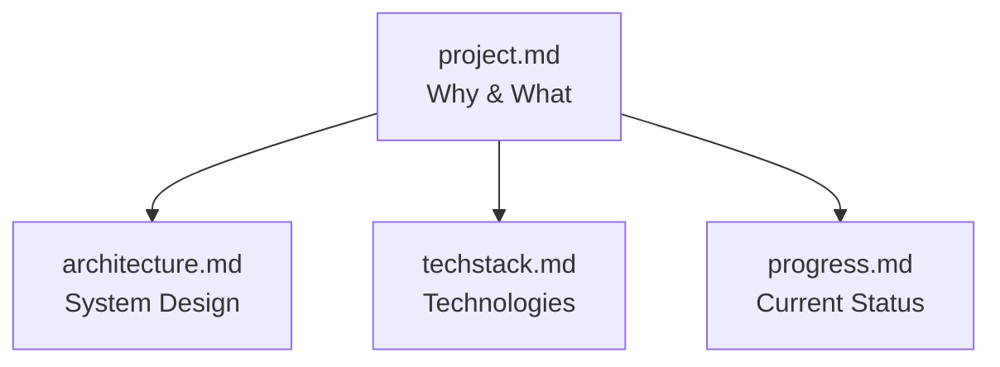

# Project Intelligence Documentation

This directory contains comprehensive structured documentation that allows Kiro to maintain context across sessions, transforming it from a stateless assistant into a persistent development partner.

## Documentation Structure

## Files Overview

### 📋 project.md
**Purpose**: Explains why this project exists and what it does

**Contains**:
- Problem statement (manual patching workflow pain points)
- Solution overview (intelligent multi-agent automation)
- Core capabilities (vulnerability analysis, SLA-aware patching, health monitoring, compliance)
- User experience examples
- Technical workflow diagrams
- Core requirements (functional and non-functional)
- Project goals and success metrics
- Target audience
- Constraints and future enhancements

**Use When**: Understanding project purpose, explaining to stakeholders, onboarding new team members

---

### 🏗️ architecture.md
**Purpose**: Documents the system architecture and design decisions

**Contains**:
- High-level architecture diagram (multi-agent system)
- Architecture characteristics (scalability, reliability, performance, security, observability)
- Component architecture (Supervisor, Vulnerability Analyst, Patch Manager, Compliance Analyst)
- Design patterns (Supervisor pattern, OUT_OF_SCOPE fallback, two-layer health checks, phased rollout, asynchronous operations)
- Data flow patterns (vulnerability discovery, SLA-aware patching, compliance reporting)
- Infrastructure architecture (AWS CDK stacks, network design, IAM permissions)
- Deployment architecture (AgentCore runtime, memory architecture)
- Key technical decisions with rationale
- Scalability considerations
- Security architecture (defense in depth, threat model)
- Performance characteristics

**Use When**: Understanding system design, making architectural decisions, troubleshooting, scaling

---

### 🛠️ techstack.md
**Purpose**: Describes technologies, frameworks, and development setup

**Contains**:
- Core technologies (AWS Strands SDK, Bedrock AgentCore, Claude Sonnet 4.5)
- AWS services integration (SSM, Inspector, Config, CloudWatch, S3, EC2)
- Development tools (Python 3.9+, AWS CDK, Docker/Finch, Git)
- Configuration management (environment variables, SLA policies, AgentCore config)
- Development setup (prerequisites, local workflow)
- Testing tools (chat client, AgentCore CLI)
- Observability stack (CloudWatch Logs, X-Ray, GenAI Dashboard)
- Deployment pipeline
- Known constraints (technical, service limits, cost)
- Development best practices (code organization, tool patterns, error handling, security)

**Use When**: Setting up development environment, understanding dependencies, troubleshooting tools, cost estimation

---

### 📊 progress.md
**Purpose**: Tracks what works and what's left to build

**Contains**:
- Current status (95% complete, production-ready demo)
- What works (core agent system, tools, infrastructure, workflows, UI, deployment, observability, documentation)
- What's left to build (production enhancements, code quality improvements, testing)
- Known issues and limitations
- Technical debt
- Performance metrics (routing, tool execution, token usage, cost)
- Recent changes (git commit history highlights)
- Next steps (immediate, short-term, long-term)
- Success criteria
- Lessons learned
- Project health assessment

**Use When**: Understanding current state, planning next features, tracking progress, identifying blockers

---

## How to Use This Documentation

### For Kiro (AI Assistant)
1. **Read project.md first** to understand project purpose and goals
2. **Reference architecture.md** when discussing system design or making technical decisions
3. **Check techstack.md** when helping with development setup or troubleshooting
4. **Consult progress.md** to understand current state and what's already implemented

### For Developers
1. **Start with project.md** to understand the "why" behind the project
2. **Review architecture.md** to understand system design and patterns
3. **Follow techstack.md** to set up development environment
4. **Check progress.md** to see what's done and what needs work

### For Stakeholders
1. **Read project.md** for high-level overview and business value
2. **Review progress.md** for current status and timeline
3. **Reference architecture.md** for technical details (if needed)

---

## Maintenance

### When to Update

**project.md**: When project goals, requirements, or scope change

**architecture.md**: When making significant architectural changes or design decisions

**techstack.md**: When adding new technologies, tools, or changing development setup

**progress.md**: Regularly (weekly or after major milestones) to track progress

### How to Update

1. Make changes directly to the relevant markdown file
2. Keep diagrams up to date (use mermaid syntax)
3. Update "Last Updated" date in progress.md
4. Ensure consistency across all files

---

## Key Project Information

**Project Name**: Intelligent Patch Automation (COP407)

**Purpose**: Multi-agent system for automated vulnerability-driven patch management

**Status**: Production-ready demo (95% complete)

**Technologies**: AWS Strands SDK, Bedrock AgentCore, Claude Sonnet 4.5, Systems Manager, Inspector, Config

**Architecture**: Supervisor pattern with 4 agents (Supervisor, Vulnerability Analyst, Patch Manager, Compliance Analyst)

**Key Features**:
- SLA-aware patching (PCI-DSS, SOC2, HIPAA)
- Risk-based scheduling (EMERGENCY vs SCHEDULED)
- Phased rollout (dev → staging → prod)
- Two-layer health checks (infrastructure + application)
- Automated compliance reporting

**Demo Environment**: 15 EC2 instances (5 dev, 5 staging, 5 prod) in us-east-1

**Cost**: ~$150-200/month (demo), ~$6,300/month (1000 instances production)

**ROI**: 78% time reduction (45 min → 10 min per CVE)

---

## Quick Links

- **Main README**: `../README.md`
- **Architecture Docs**: `../doc/architecture.md`
- **Demo Script**: `../doc/DEMO_SCRIPT.md`
- **Deployment**: `../deploy.sh`
- **Chat Client**: `../chat.sh`

---

## Questions?

For questions about this documentation system or the project:
1. Check the relevant documentation file first
2. Review existing code and comments
3. Check git commit history for context
4. Ask Kiro (with context from these files)

---

**Last Updated**: January 28, 2026
