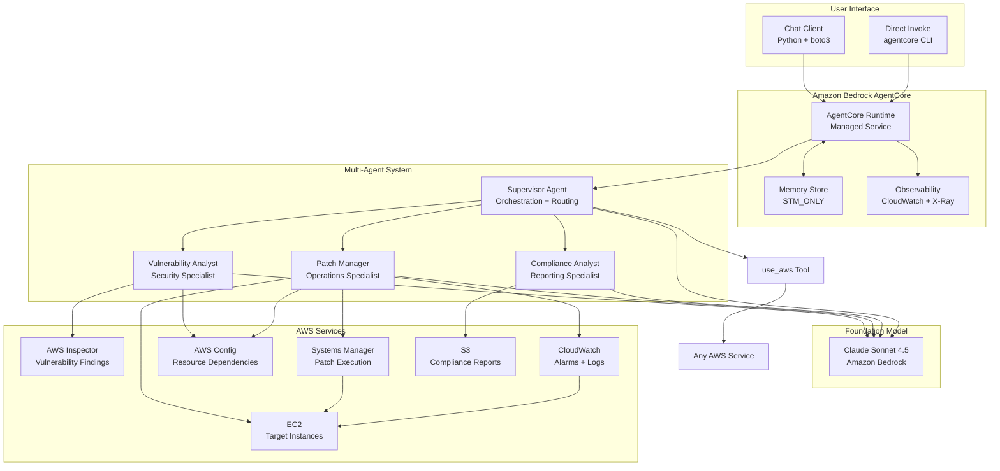
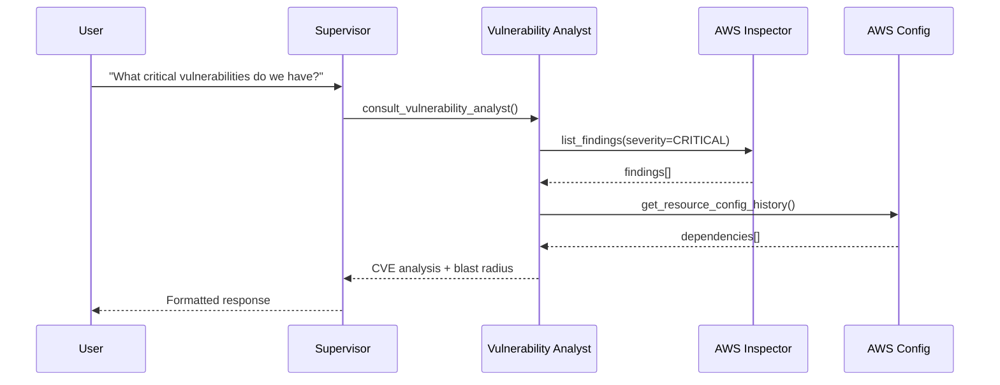
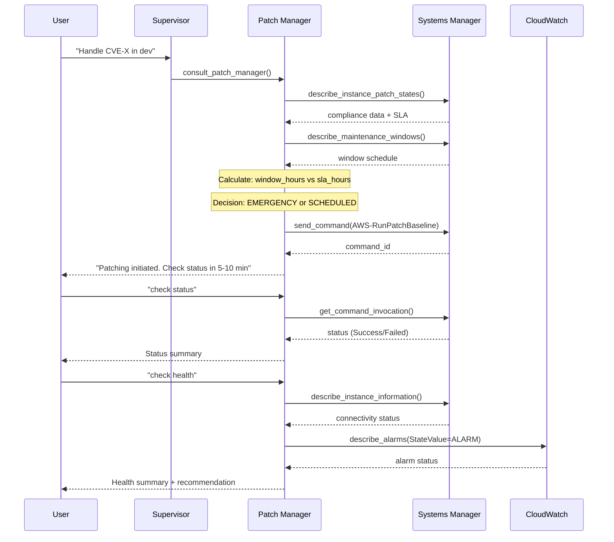
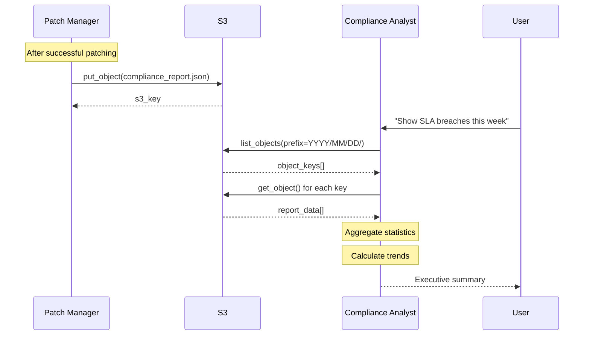

# System Architecture

## High-Level Architecture



## Architecture Characteristics

### Scalability
- **Managed Runtime**: AgentCore handles scaling automatically
- **Asynchronous Operations**: SSM commands don't block agent execution
- **Parallel Processing**: ThreadPoolExecutor for status checks (10 threads)
- **Stateless Agents**: Each invocation is independent

### Reliability
- **Graceful Degradation**: OUT_OF_SCOPE fallback when specialists fail
- **Retry Logic**: AWS SDK automatic retries for transient failures
- **Idempotent Operations**: Safe to retry patch commands
- **Health Verification**: Two-layer checks before proceeding

### Performance
- **Keyword-Based Routing**: 18-36% faster than LLM-based routing
- **Single API Calls**: Optimized queries (e.g., check_cloudwatch_alarms)
- **Batch Operations**: Parallel instance status checks
- **Efficient Pagination**: use_aws tool handles large result sets

### Security
- **Least Privilege IAM**: Read-only access to most services
- **Approval Gates**: Human approval between environments
- **Audit Trail**: CloudWatch Logs + S3 compliance reports
- **No Admin Access**: Cannot modify infrastructure

### Observability
- **CloudWatch Logs**: All agent conversations and tool calls
- **X-Ray Tracing**: Distributed operation tracking
- **GenAI Dashboard**: Token usage and performance metrics
- **SSM Command History**: Patch execution audit trail

## Component Architecture

### Supervisor Agent

**Responsibility**: Orchestrate workflow and route queries to specialists

**Key Design Decisions**:
1. **Only agent with use_aws access** - Enforces separation of concerns
2. **Keyword-based routing** - Fast, transparent, debuggable
3. **OUT_OF_SCOPE fallback** - Retry with use_aws when specialists fail
4. **No domain logic** - Pure orchestration, delegates all work

**Routing Algorithm**:
```python
def route_query(query: str) -> str:
    keywords = extract_keywords(query.lower())
    
    if any(k in keywords for k in ['cve', 'vulnerability', 'cvss', 'security']):
        return 'vulnerability_analyst'
    elif any(k in keywords for k in ['patch', 'instance', 'health', 'rollback']):
        return 'patch_manager'
    elif any(k in keywords for k in ['report', 'compliance', 'sla', 'audit']):
        return 'compliance_analyst'
    elif any(k in keywords for k in ['lambda', 's3', 'rds', 'cloudwatch']):
        return 'use_aws'
    else:
        return 'use_aws'  # Default fallback
```

**Tools**:
- `consult_vulnerability_analyst()` - Delegate to security specialist
- `consult_patch_manager()` - Delegate to operations specialist
- `consult_compliance_analyst()` - Delegate to reporting specialist
- `use_aws()` - Built-in tool from strands_tools for AWS service access

### Vulnerability Analyst Agent

**Responsibility**: Security threat analysis and risk assessment

**Key Design Decisions**:
1. **No patching logic** - Returns OUT_OF_SCOPE for infrastructure queries
2. **Environment-aware** - Filters findings by environment tags
3. **Blast radius focus** - Uses AWS Config for dependency analysis
4. **CVSS-driven** - Severity classification drives SLA calculation

**Tools**:
- `get_vulnerability_findings(cve_id, severity, environment)` - Query Inspector
- `get_resource_dependencies(instance_id)` - Blast radius via Config

**Behavior Pattern**:
```python
if query_about_patching or query_about_infrastructure:
    return "OUT_OF_SCOPE: Infrastructure queries require Patch Manager"
elif query_about_cve:
    findings = get_vulnerability_findings(cve_id=cve_id)
    return analyze_threat(findings)
```

### Patch Manager Agent

**Responsibility**: Infrastructure operations and patch execution

**Key Design Decisions**:
1. **One environment per invocation** - Enforces phased rollout
2. **Asynchronous workflow** - Returns command_id immediately
3. **Two-layer health checks** - Infrastructure + application
4. **SLA-aware scheduling** - EMERGENCY vs SCHEDULED decisions
5. **No use_aws access** - Stays focused on patching domain

**Tools** (11 specialized):
- `get_patch_compliance(environment, severity)` - Patch states + SLA
- `execute_patch_operation(instance_ids)` - Async SSM patching
- `get_command_status(command_id, instance_ids)` - Check status
- `check_instance_health(instance_ids)` - SSM connectivity
- `check_cloudwatch_alarms(instance_ids, alarm_name_pattern)` - App health
- `rollback_patches(instance_ids)` - Restore via yum history
- `get_resource_dependencies(instance_id)` - Blast radius
- `get_maintenance_windows(environment)` - Query schedules
- `create_maintenance_window(...)` - Create windows
- `verify_and_proceed(instance_ids, environment)` - Automated verification
- `generate_compliance_report(...)` - Audit trails

**Workflow Pattern**:
```python
# Phase 1: Analysis
compliance = get_patch_compliance(environment="dev", severity="CRITICAL")
windows = get_maintenance_windows(environment="dev")
decision = calculate_decision(compliance.sla_hours, windows.next_execution_hours)

# Phase 2: Execution
command_id = execute_patch_operation(instance_ids)
wait_for_user("check status")

# Phase 3: Verification
status = get_command_status(command_id, instance_ids)
wait_for_user("check health")
health = check_instance_health(instance_ids)
alarms = check_cloudwatch_alarms(instance_ids)

# Phase 4: Approval
if health.healthy and alarms.no_alarms:
    wait_for_user("proceed")
    # Move to next environment
```

### Compliance Analyst Agent

**Responsibility**: Executive reporting and audit trail analysis

**Key Design Decisions**:
1. **S3-based queries** - Date-partitioned for efficiency
2. **Trend analysis** - Current vs previous period comparison
3. **Executive focus** - Aggregated statistics, not raw data
4. **No use_aws access** - Stays focused on compliance domain

**Tools**:
- `query_compliance_reports(days_back, severity, environment, sla_breaches_only)`

**Behavior Pattern**:
```python
if query_about_patching or query_about_security:
    return "OUT_OF_SCOPE: Patching queries require Patch Manager"
elif query_about_compliance:
    reports = query_compliance_reports(days_back=7)
    statistics = aggregate_statistics(reports)
    trends = calculate_trends(reports)
    return executive_summary(statistics, trends)
```

## Design Patterns

### 1. Supervisor Pattern

**Problem**: Complex workflows require coordination across multiple specialists

**Solution**: Central orchestrator that routes queries and manages workflow state

**Benefits**:
- Clear separation of concerns
- Easy to add new specialists
- Centralized error handling
- Transparent routing logic

**Implementation**:
```python
class Supervisor:
    def handle_query(self, query: str):
        specialist = self.route(query)
        response = specialist.execute(query)
        
        if response == "OUT_OF_SCOPE":
            return self.fallback_tool.execute(query)
        
        return response
```

### 2. OUT_OF_SCOPE Fallback

**Problem**: Specialists may receive queries outside their domain

**Solution**: Explicit OUT_OF_SCOPE response triggers supervisor retry with fallback

**Benefits**:
- Prevents routing loops
- Improves routing accuracy over time
- Graceful degradation
- Clear error messages

**Implementation**:
```python
# Specialist agent
if query_outside_domain:
    return "OUT_OF_SCOPE: [reason] requires [correct specialist]"

# Supervisor
if response.startswith("OUT_OF_SCOPE"):
    return use_aws_tool.execute(query)
```

### 3. Two-Layer Health Checks

**Problem**: Need to verify both infrastructure and application health

**Solution**: Sequential checks at different layers with appropriate wait times

**Benefits**:
- Catches both infrastructure and application failures
- Prevents false positives
- Enables safe rollback decisions
- Uses existing AWS primitives

**Implementation**:
```python
def verify_health(instance_ids):
    # Layer 1: Infrastructure
    ssm_health = check_instance_health(instance_ids)
    
    # Layer 2: Application (wait for alarm evaluation)
    time.sleep(120)  # 2 minutes for CloudWatch
    alarm_health = check_cloudwatch_alarms(instance_ids)
    
    return ssm_health.healthy and alarm_health.no_alarms
```

### 4. Phased Rollout with Approval Gates

**Problem**: Need to patch multiple environments safely with human oversight

**Solution**: One environment at a time with explicit approval between phases

**Benefits**:
- Limits blast radius
- Enables early detection of issues
- Maintains human control
- Supports both fast and production modes

**Implementation**:
```python
for environment in ['dev', 'staging', 'prod']:
    patch_environment(environment)
    verify_health(environment)
    wait_for_approval()  # Human says "proceed"
```

### 5. Asynchronous Operations

**Problem**: SSM patch commands take 5-10 minutes to complete

**Solution**: Return command_id immediately, user checks status when ready

**Benefits**:
- Prevents timeout issues
- Enables parallel operations
- User controls workflow pace
- Supports long-running operations

**Implementation**:
```python
# Execute (returns immediately)
command_id = ssm.send_command(...)
return f"Patching initiated. Command ID: {command_id}"

# Check status (when user is ready)
status = ssm.get_command_invocation(command_id, instance_id)
```

## Data Flow Patterns

### Vulnerability Discovery Flow



### SLA-Aware Patching Flow



### Compliance Reporting Flow



## Infrastructure Architecture

### AWS CDK Stacks

```mermaid
flowchart TB
    subgraph Networking Stack
        VPC[VPC<br/>10.0.0.0/16]
        PubSub[Public Subnet<br/>10.0.1.0/24]
        PrivSub[Private Subnet<br/>10.0.2.0/24]
        IGW[Internet Gateway]
        NAT[NAT Gateway]
        
        VPC --> PubSub
        VPC --> PrivSub
        PubSub --> IGW
        PrivSub --> NAT
    end
    
    subgraph Security Stack
        SG[Security Groups<br/>SSH + HTTP]
        IAM_EC2[IAM Role<br/>EC2 + SSM]
        IAM_Agent[IAM Role<br/>AgentCore]
        Config[AWS Config<br/>Resource Tracking]
        S3_Reports[S3 Bucket<br/>Compliance Reports]
    end
    
    subgraph Demo Stack
        Dev[5 Dev Instances<br/>Amazon Linux 2]
        Staging[5 Staging Instances<br/>Amazon Linux 2]
        Prod[5 Prod Instances<br/>Amazon Linux 2]
        MW_Dev[Maintenance Window<br/>Daily 1AM UTC]
        MW_Staging[Maintenance Window<br/>Tue 2AM UTC]
        MW_Prod[Maintenance Window<br/>1st of month 2AM]
        CW_Alarms[CloudWatch Alarms<br/>httpd monitoring]
    end
    
    subgraph AgentCore Permissions
        Policies[IAM Policies<br/>25+ AWS Services]
    end
    
    Networking Stack --> Security Stack
    Security Stack --> Demo Stack
    Security Stack --> AgentCore Permissions
```

### Network Architecture

**VPC Design**:
- CIDR: 10.0.0.0/16
- Public Subnet: 10.0.1.0/24 (NAT Gateway)
- Private Subnet: 10.0.2.0/24 (EC2 instances)

**Internet Access**:
- Public subnet: Internet Gateway
- Private subnet: NAT Gateway (for SSM, Inspector, yum updates)

**Security Groups**:
- SSH: Port 22 (restricted to specific IPs in production)
- HTTP: Port 80 (for httpd service)
- Egress: All traffic (for AWS service endpoints)

### IAM Permission Model

**EC2 Instance Role**:
```json
{
  "Version": "2012-10-17",
  "Statement": [
    {
      "Effect": "Allow",
      "Action": [
        "ssm:UpdateInstanceInformation",
        "ssm:ListAssociations",
        "ssm:ListInstanceAssociations",
        "ssmmessages:*",
        "ec2messages:*"
      ],
      "Resource": "*"
    }
  ]
}
```

**AgentCore Role** (Least Privilege):
```json
{
  "Version": "2012-10-17",
  "Statement": [
    {
      "Effect": "Allow",
      "Action": [
        "ec2:Describe*",
        "ssm:Describe*",
        "ssm:Get*",
        "ssm:List*",
        "ssm:SendCommand",
        "inspector2:List*",
        "config:Get*",
        "config:Describe*",
        "cloudwatch:Describe*",
        "s3:PutObject"
      ],
      "Resource": "*"
    }
  ]
}
```

## Deployment Architecture

### AgentCore Runtime

**Deployment Model**:
- Managed service (no infrastructure to maintain)
- Automatic scaling based on request volume
- Built-in observability (CloudWatch + X-Ray)
- Container-based (Docker image in ECR)

**Configuration**:
```yaml
platform: linux/arm64
container_runtime: finch
network_mode: PUBLIC
protocol: HTTP
memory_mode: STM_ONLY
observability: enabled
```

**Deployment Process**:
1. Build Docker image from agent code
2. Push to ECR repository
3. AgentCore pulls image and deploys
4. Runtime becomes available at HTTPS endpoint

### Memory Architecture

**Mode**: STM_ONLY (Short-Term Memory)

**Characteristics**:
- Session-based conversation context
- Shared across all agents via globals.py
- 7-day event expiry
- No long-term memory persistence

**Implementation**:
```python
# helper/globals.py
MEMORY_ID = None  # Shared across agents
SESSION_ID = None  # Per conversation

# helper/memory_hooks.py
def store_conversation(actor, message):
    memory_client.store_event(
        memory_id=MEMORY_ID,
        session_id=SESSION_ID,
        actor=actor,
        content=message
    )
```

## Key Technical Decisions

### 1. Why Keyword-Based Routing?

**Alternatives Considered**:
- LLM-based routing (additional LLM call per query)
- Rule-based routing (rigid, hard to maintain)
- Embedding-based routing (complex, overkill)

**Decision**: Keyword-based routing

**Rationale**:
- 18-36% faster than LLM-based routing
- Transparent and debuggable
- Easy to extend with new keywords
- OUT_OF_SCOPE provides safety net
- No additional LLM costs

### 2. Why Asynchronous Patching?

**Alternatives Considered**:
- Synchronous (wait for completion)
- Polling (agent checks status automatically)
- Webhooks (callback when complete)

**Decision**: Asynchronous with user-initiated status checks

**Rationale**:
- Prevents timeout issues (5-10 min patches)
- User controls workflow pace
- Supports both fast and production modes
- Simple implementation (no webhooks)
- Enables phased rollout with approval gates

### 3. Why Two-Layer Health Checks?

**Alternatives Considered**:
- SSM-only (infrastructure)
- CloudWatch-only (application)
- Custom health check scripts

**Decision**: Two-layer (SSM + CloudWatch)

**Rationale**:
- Catches both infrastructure and application failures
- Uses existing AWS primitives (no new infrastructure)
- 2-minute wait for alarm evaluation prevents false positives
- Integrated with rollback workflow

### 4. Why Built-in use_aws Tool?

**Alternatives Considered**:
- Custom AWS tool implementation
- Give all agents use_aws access
- No fallback tool

**Decision**: Built-in use_aws from strands_tools, only Supervisor has access

**Rationale**:
- Standard library tool (no maintenance)
- Enforces separation of concerns
- Automatic pagination support
- Consistent error handling
- Only Supervisor needs broad AWS access

### 5. Why Helper Module Organization?

**Alternatives Considered**:
- Flat structure (all files in agent/)
- Nested by agent (agent/supervisor/tools.py)
- Separate tools package

**Decision**: helper/ subdirectory for utilities

**Rationale**:
- Clear separation: agents at top level, utilities in helper/
- Easy to navigate (4 agent files visible immediately)
- Cleaner imports
- Follows Python conventions

## Scalability Considerations

### Current Limitations

1. **Single Region**: Deployed to us-east-1 only
2. **15 Demo Instances**: Not production-scale tested
3. **Sequential Patching**: One environment at a time
4. **Manual Approval**: Human required between environments

### Scaling to Production

**100s of Instances**:
- Parallel patching within environment (SSM supports 50 concurrent)
- Batch status checks (already implemented with ThreadPoolExecutor)
- Pagination for large result sets (use_aws tool supports)

**1000s of Instances**:
- Multiple AgentCore runtimes (load balancing)
- Distributed patching (multiple regions)
- Async status checks (webhooks instead of polling)
- Automated approval (circuit breakers, canary rollout)

**Multi-Region**:
- Deploy AgentCore runtime per region
- Regional S3 buckets for compliance reports
- Cross-region replication for audit trail
- Regional maintenance windows

## Security Architecture

### Defense in Depth

**Layer 1: Network**
- Private subnets for EC2 instances
- Security groups restrict traffic
- NAT Gateway for outbound only

**Layer 2: IAM**
- Least privilege permissions
- Read-only access to most services
- Write access only for SSM commands and S3 reports
- No infrastructure modification permissions

**Layer 3: Application**
- Approval gates between environments
- Rollback requires explicit user confirmation
- Audit trail for all actions
- OUT_OF_SCOPE prevents unauthorized operations

**Layer 4: Observability**
- CloudWatch Logs for all agent actions
- X-Ray tracing for distributed operations
- SSM command history for patch operations
- S3 compliance reports for audit trail

### Threat Model

**Threats Mitigated**:
- Unauthorized patching: Approval gates + IAM permissions
- Data exfiltration: Read-only access to most services
- Infrastructure modification: No admin permissions
- Audit trail tampering: S3 bucket policies + versioning

**Threats Not Mitigated** (by design):
- Malicious user with valid credentials: Trust boundary
- Compromised foundation model: Bedrock security responsibility
- AWS service outages: Graceful degradation only

## Performance Characteristics

### Response Time Targets

| Operation | Target | Actual | Notes |
|-----------|--------|--------|-------|
| Information query | < 5s | 3-5s | Single LLM call + AWS API |
| Routing decision | < 2s | 1-2s | Keyword matching |
| Patch execution | 5-10min | 5-10min | Async SSM operation |
| Status check | < 3s | 1-2s | Parallel queries |
| Health check (infra) | < 3s | 2-3s | SSM API call |
| Health check (app) | < 3s | 1-2s | CloudWatch API call |
| Compliance query | < 5s | 3-5s | S3 list + download |

### Optimization Techniques

1. **Parallel Processing**: ThreadPoolExecutor for status checks (10 threads)
2. **Single API Calls**: Optimized queries (e.g., check_cloudwatch_alarms)
3. **Keyword Routing**: 18-36% faster than LLM-based routing
4. **Batch Operations**: Describe multiple instances in one call
5. **Efficient Pagination**: use_aws tool handles large result sets
6. **Date Partitioning**: S3 compliance reports (YYYY/MM/DD/)

### Token Usage

**Average Tokens per Query**:
- Information query: 500-1000 tokens
- Patching workflow: 2000-3000 tokens (multiple turns)
- Compliance query: 1000-1500 tokens

**Cost Optimization**:
- Keyword routing (no additional LLM calls)
- Structured tool responses (minimal tokens)
- OUT_OF_SCOPE prevents wasted specialist calls
- Efficient prompts (no unnecessary context)
