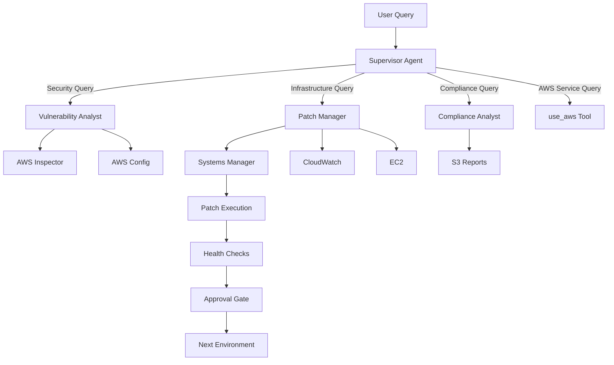

# Project Overview

## Why This Project Exists

Traditional vulnerability-driven patch management is a manual, time-consuming process that requires security teams to:
- Monitor multiple vulnerability feeds and AWS Inspector findings
- Manually assess CVE severity and business impact
- Check compliance requirements (PCI-DSS, SOC2, HIPAA) for SLA deadlines
- Coordinate with operations teams for maintenance windows
- Execute patches across multiple environments (dev → staging → prod)
- Verify health after patching and handle rollbacks
- Generate compliance reports for auditors

**The Problem:** This workflow requires 15 browser tabs, 3 CLI tools, and 45 minutes of manual work per CVE. It's error-prone, doesn't scale, and creates compliance risks when SLA deadlines are missed.

**The Solution:** An intelligent multi-agent system that automates the entire vulnerability-driven patching workflow using natural language, making risk-based decisions using maintenance windows and CVSS scores.

## What This Project Does

This is a **multi-agent patch automation system** built for AWS re:Invent 2025 session COP407. It demonstrates how to build production-grade agentic AI solutions using:
- **AWS Strands SDK** - Framework for building model-first applications
- **Amazon Bedrock AgentCore** - Managed runtime for deploying agents at scale
- **Claude Sonnet 4.5** - Foundation model for reasoning and decision-making
- **AWS Systems Manager** - Patch execution and compliance tracking
- **AWS Inspector** - Vulnerability discovery
- **AWS Config** - Resource dependency tracking

### Core Capabilities

**Intelligent Vulnerability Analysis:**
- Query AWS Inspector for active CVE findings
- CVSS scoring and threat classification
- Blast radius assessment using AWS Config
- Environment-based filtering

**SLA-Aware Patch Management:**
- Automatic compliance framework detection (PCI-DSS, SOC2, HIPAA)
- Risk-based scheduling: EMERGENCY vs SCHEDULED patching
- Maintenance window integration with acceptable delay calculation
- Phased rollout: dev → staging → prod with approval gates

**Two-Layer Health Monitoring:**
- Infrastructure health: SSM connectivity verification
- Application health: CloudWatch alarm monitoring
- Automated health checks after patching
- User-approved rollback with health verification

**Compliance Reporting:**
- Automated audit trail generation
- S3 storage with date partitioning (YYYY/MM/DD/)
- Queryable reports for executive insights
- SLA breach tracking and trend analysis

## How It Works

### User Experience

```bash
You: "Handle CVE-2025-38527 in dev environment"

🤖 Agent: Analyzing CVE-2025-38527...
         CVSS: 9.8 (CRITICAL) - Remote code execution
         Affected: 5 instances in dev environment
         
         SLA Analysis:
         • Compliance: PCI-DSS
         • Required: Patch within 12 hours
         • Next Window: 36 hours away
         • Decision: EMERGENCY (delay unacceptable)
         
         Initiating emergency patching for dev environment...
         Command ID: abc-123-def
         
         Status: Patching in progress (5-10 minutes)
         
You: "check status"

🤖 Agent: Patch Status:
         • Success: 5/5 instances
         • Failed: 0/5 instances
         • Duration: 8 minutes
         
         Waiting 2 minutes for health checks...
         
You: "check health"

🤖 Agent: Health Check Results:
         Infrastructure: ✅ All instances connected to SSM
         Application: ✅ No CloudWatch alarms firing
         
         Dev environment is healthy. Ready to proceed to staging?
         
You: "proceed"

🤖 Agent: Moving to staging environment...
         [Repeats workflow for staging → prod]
```

### Technical Workflow



## Core Requirements

### Functional Requirements

1. **Vulnerability Discovery**
   - Query AWS Inspector for active CVE findings
   - Filter by severity (CRITICAL, HIGH, MEDIUM, LOW)
   - Filter by environment (dev, staging, prod)
   - Return CVSS scores and affected resources

2. **SLA-Aware Decision Making**
   - Detect compliance frameworks from instance tags
   - Calculate SLA requirements based on severity
   - Compare maintenance window timing vs SLA deadline
   - Decide: EMERGENCY (immediate) vs SCHEDULED (wait for window)

3. **Phased Patch Execution**
   - Execute patches asynchronously via SSM
   - One environment at a time (dev → staging → prod)
   - Human approval required between environments
   - Track command status and completion

4. **Health Verification**
   - Infrastructure: SSM connectivity checks
   - Application: CloudWatch alarm monitoring
   - 2-minute wait for alarm evaluation
   - Rollback capability if issues detected

5. **Compliance Reporting**
   - Generate audit trails with decision rationale
   - Store in S3 with date partitioning
   - Query reports for executive insights
   - Track SLA breaches and trends

### Non-Functional Requirements

1. **Performance**
   - Information queries: < 5 seconds
   - Patch execution: 5-10 minutes (async)
   - Health checks: < 5 seconds
   - Routing decisions: < 2 seconds

2. **Reliability**
   - Graceful degradation when specialists fail
   - OUT_OF_SCOPE fallback for misrouted queries
   - Retry logic for transient AWS API failures
   - Idempotent operations

3. **Security**
   - Least privilege IAM permissions
   - Read-only access to most AWS services
   - Write access only for SSM commands and S3 reports
   - No infrastructure modification permissions
   - Audit trail for all actions

4. **Observability**
   - CloudWatch Logs for all agent actions
   - X-Ray tracing for distributed operations
   - GenAI Dashboard for token usage and performance
   - SSM command history for patch operations

5. **Maintainability**
   - Modular agent architecture
   - Externalized configuration (SLA policies in JSON)
   - Clear separation of concerns
   - Comprehensive documentation

## Project Goals

### Primary Goals

1. **Demonstrate Production-Grade Agentic AI**
   - Show how to build reliable, scalable agent systems
   - Prove agents can make intelligent, risk-based decisions
   - Demonstrate proper error handling and fallback logic

2. **Reduce Manual Toil**
   - Automate 45-minute manual workflow to 10-minute automated workflow
   - Eliminate context switching between tools
   - Reduce human error in patching decisions

3. **Improve Compliance Posture**
   - Automatic SLA tracking and enforcement
   - Audit trail for every patching decision
   - Reduce SLA breach risk through intelligent scheduling

4. **Enable Natural Language Operations**
   - No rigid commands or syntax to learn
   - Conversational interface for complex workflows
   - Context-aware responses

### Secondary Goals

1. **Educational Content**
   - Teach best practices for building agents
   - Show real-world AWS integration patterns
   - Demonstrate proper prompt engineering

2. **Reusable Patterns**
   - Supervisor pattern for multi-agent orchestration
   - OUT_OF_SCOPE fallback for routing errors
   - Two-layer health check pattern
   - Phased rollout with approval gates

3. **AWS Service Integration**
   - Show how to integrate Inspector, Config, SSM, CloudWatch
   - Demonstrate proper IAM permission scoping
   - Use AWS native services (no new infrastructure)

## Target Audience

**Primary:** AWS customers building agentic AI solutions for operations automation

**Secondary:** 
- Security teams looking to automate vulnerability management
- Operations teams seeking to reduce manual patching toil
- Compliance teams needing better audit trails
- Developers learning to build with Bedrock AgentCore

## Success Metrics

1. **Workflow Efficiency**
   - Manual process: 45 minutes per CVE
   - Automated process: 10 minutes per CVE (with approval gates)
   - 78% time reduction

2. **Routing Accuracy**
   - 18-36% performance improvement via keyword-based routing
   - < 5% OUT_OF_SCOPE fallback rate
   - Zero routing loops

3. **Compliance**
   - 100% audit trail coverage
   - < 1% SLA breach rate
   - Automated compliance report generation

4. **Reliability**
   - 99%+ successful patch execution rate
   - < 1% rollback rate
   - Zero data loss or corruption

## Project Constraints

1. **AWS-Only**
   - Built for AWS services only
   - No multi-cloud support (by design)

2. **Linux-Only**
   - yum-based rollback for Amazon Linux/RHEL
   - No Windows support in current version

3. **Single Region**
   - Deployed to us-east-1 only
   - No multi-region support

4. **Demo Environment**
   - 15 EC2 instances (5 dev, 5 staging, 5 prod)
   - Not production-scale testing

5. **Manual Approval Gates**
   - Human approval required between environments
   - No fully automated prod patching

## Future Enhancements

1. **Multi-Region Support** - Deploy agents across multiple AWS regions
2. **Windows Support** - Add Windows Update integration via SSM
3. **Automated Rollback** - Remove human approval for rollback decisions
4. **Slack/Teams Integration** - Notifications and approval workflows
5. **Custom Patch Baselines** - CVE-specific filtering in SSM
6. **LLM-Based Routing** - If keyword routing shows >10% misrouting
7. **Cost Tracking** - Token usage and cost optimization
8. **Multi-Cloud** - Extend to Azure and GCP
