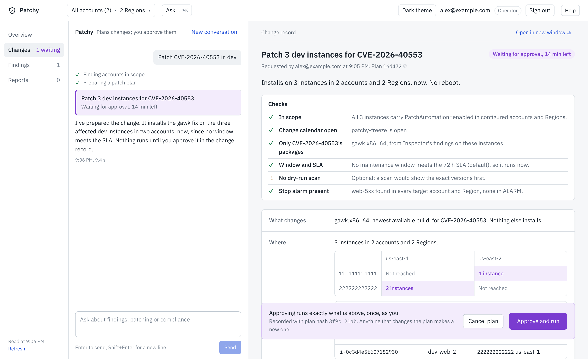
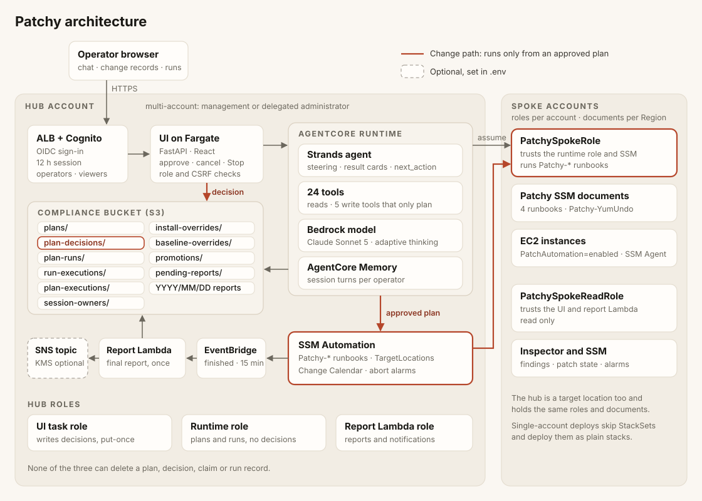

> **Disclaimer.** This is a proof of concept for exploring AI agents in operations, not a production system. What you type is processed and stored by several AWS services (Amazon Bedrock, AgentCore Memory, Amazon S3, CloudWatch Logs, Amazon Cognito); handling that data appropriately is your responsibility as the deployer.

# Patchy: agentic patch management for Amazon EC2

Patchy is an AI agent that plans EC2 patching from plain-English requests and runs a change only after an operator approves it. Ask "Patch CVE-2026-40553 in dev" and Patchy finds the affected instances, checks the SLA against your maintenance windows, works out what to install, and prepares a change record. Nothing touches an instance until an operator reviews that record and clicks Approve and run. The run goes out through AWS Systems Manager Automation, across accounts and Regions if you configure them, and a compliance report lands in S3 when it ends.



It is built on the [Strands Agents SDK](https://github.com/strands-agents/sdk-python) and hosted on [Amazon Bedrock AgentCore](https://docs.aws.amazon.com/bedrock-agentcore/latest/devguide/what-is-bedrock-agentcore.html). The parts worth reading if you build agents of your own are the approval model (the agent can store a plan but can't approve one, and IAM enforces that), the deterministic steering that checks tool calls before they run, and the change record each plan stores.

## How a change happens

1. You ask. In the chat, for example "Patch CVE-2026-40553 in dev" or "Patch all HIGH findings in staging".
2. Patchy plans. It checks scope, the Change Calendar, the SLA deadline against your maintenance windows, the earlier environment's verification, and whether your stop alarm exists in every target location. If a window will patch in time, it says so and plans nothing. Otherwise it stores a plan.
3. You review the change record. It opens beside the chat and lists what installs, every target instance by name, account and Region, when it runs, how it rolls out, what stops it, and how to undo it. The checks Patchy made are at the top.
4. An operator approves. Approval runs exactly the stored plan, once. Typing "yes" in the chat runs nothing.
5. You follow the run. The run view shows progress by account and Region. Stop run cancels every location of the plan.
6. A report is written. When the run ends, a compliance report with the SLA outcome is stored in S3, shown under Reports, and optionally sent to an SNS topic.

## What it does

- Answers questions about your fleet: findings by severity, where a CVE is, patch compliance, which findings will miss their SLA, what a past run did.
- Patches a CVE narrowly. A CVE request installs only the OS packages Amazon Inspector lists for that CVE. A severity request installs approved patches at that level and above.
- Rolls out by environment policy. Dev, staging and prod each have fixed concurrency and error limits; prod goes one account and Region at a time and stops at the first failure. A request can't change them.
- Respects your change controls: an SSM Change Calendar, a CloudWatch alarm that stops a run, and an optional rule that staging needs a verified dev run first and prod a verified staging run.
- Verifies fixes against Inspector per instance, and says why a finding is still open (reboot pending, rescan due, fix not installed).
- Rolls back the yum and dnf transactions a recorded Patchy run made, and nothing else.
- Keeps a record: every plan, decision, run and report is a create-only object in S3.

## What it doesn't do

- Change anything on its own. The agent stores plans; only an operator's approval in the UI runs one.
- Create CloudWatch alarms. It reads the ones you have.
- Patch language packages (pip, npm). A CVE that only they fix is listed, not patched.
- Roll back outside the yum and dnf family, or undo changes Patchy didn't make.
- Promote between environments by itself. Each environment is its own plan and approval.

## Architecture



Everything runs in a hub account: the UI on ECS Fargate behind an Application Load Balancer with Amazon Cognito sign-in, the agent on the AgentCore Runtime, the compliance bucket, and a Lambda function that writes reports. Each spoke account holds two Patchy IAM roles and the Patchy SSM documents; nothing else runs there. The red line in the diagram is the change path, which only an approved plan travels. [`docs/architecture.md`](docs/architecture.md) explains each part.

## Try it

You need Python 3.11+, Node.js 20+, the AgentCore CLI 0.20.1 (the deploy installs it if it's missing), Docker or Finch, and the AWS CLI v2, plus an AWS account with Bedrock access to Claude Sonnet 5, Systems Manager Quick Setup, SSM Explorer and Amazon Inspector enabled. [`docs/deploying.md`](docs/deploying.md#prerequisites) lists every prerequisite with links.

```bash
cp .env.example .env
# Set AWS_PROFILE and AWS_REGION. For a demo also set ALLOW_SELF_SIGNED_CERT=true;
# otherwise set ACM_CERTIFICATE_ARN to a certificate browsers trust.

./deploy.sh              # 25 to 30 minutes the first time
./deploy.sh create-user  # email, temporary password, operator or viewer
./deploy.sh status       # prints the UI URL
```

Tag the instances Patchy may manage with `PatchAutomation=enabled` and `Environment=dev`, `staging` or `prod`. To get a small fleet to try it on, `./sample-env.sh deploy` creates five tagged instances across the three environments.

Things to ask:

```
What critical vulnerabilities do we have in dev?
Where is CVE-2026-40553 across the fleet?
Which findings in prod will miss their SLA?
Patch CVE-2026-40553 in dev
Patch HIGH and above in staging
Did CVE-2026-40553 get fixed on i-0abc1234567890def?
Roll back the last dev patch run
```

Patching across several AWS accounts and Regions is covered in [`docs/deploying.md`](docs/deploying.md#multi-account-and-multi-region).

## Documentation

| Read this | When you want to |
|---|---|
| [`docs/deploying.md`](docs/deploying.md) | Deploy, configure, add accounts, upgrade or tear down |
| [`docs/operations.md`](docs/operations.md) | Use Patchy day to day: asking, approving, stopping, tags and SLAs, users |
| [`docs/architecture.md`](docs/architecture.md) | Understand how a request becomes a run, and the safety controls on the way |
| [`docs/security.md`](docs/security.md) | Review authentication, IAM, the audit trail and hardening |
| [`docs/troubleshooting.md`](docs/troubleshooting.md) | Fix a refusal or an error, and find the logs |
| [`docs/extending.md`](docs/extending.md) | Add tools, cards, Automation documents or OS support |

## Repository layout

```
agent/        The agent: entrypoint, tools, steering, plans, and the tool-selection eval
infra/        CDK stacks: network, core (bucket and runtime policy), UI, spoke roles, SSM documents, sample fleet
ui/           FastAPI API, report Lambda, React frontend
docs/         The documents above
deploy.sh     Deploys, updates, inspects and removes the solution
sample-env.sh Creates or removes the sample EC2 fleet
setup-tls.sh  Imports a self-signed demo certificate into ACM
connect-ui.sh Opens an internal ALB through SSM port forwarding
```

## Contributing

Issues and pull requests are welcome; for anything substantial, open an issue first so we can agree the design. Before you submit a change to the agent's prompt or tools, run the tool-selection eval described in [`agent/eval/README.md`](agent/eval/README.md). See [CONTRIBUTING.md](CONTRIBUTING.md) for the process.

## Security

This sample is not production-ready. Work out how the [AWS Shared Responsibility Model](https://aws.amazon.com/compliance/shared-responsibility-model/) applies to your use and add the controls you need; [`docs/security.md`](docs/security.md) describes what the sample provides and what it leaves to you. See [CONTRIBUTING](CONTRIBUTING.md#security-issue-notifications) to report a security issue.

## Licence

MIT-0. See [LICENSE](LICENSE).

The UI bundles the IBM Plex Sans and IBM Plex Mono typefaces (from the `@fontsource` packages), which are licensed under the [SIL Open Font License 1.1](https://openfontlicense.org).
