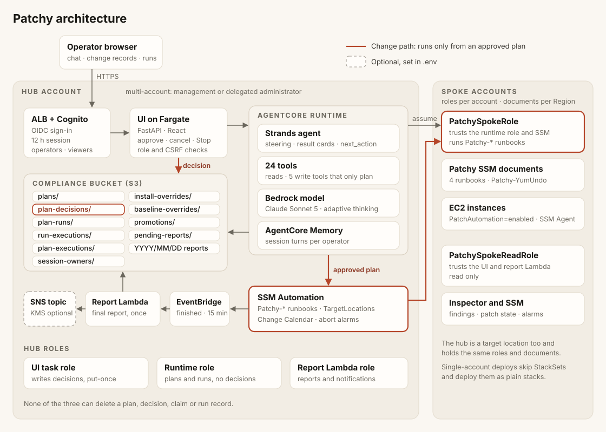

# Architecture

How Patchy turns a request into a run, and the controls on the way. For permissions and the audit trail in detail, see [Security](security.md).

- [Components](#components)
- [From request to report](#from-request-to-report)
- [The agent](#the-agent)
- [Plans and approval](#plans-and-approval)
- [Running a change](#running-a-change)
- [What installs](#what-installs)
- [After a run](#after-a-run)
- [Fleet discovery](#fleet-discovery)
- [Conversation memory](#conversation-memory)
- [Stacks](#stacks)

## Components

| Component | Built on | Does |
|---|---|---|
| Load balancer | Application Load Balancer, Amazon Cognito | Signs users in, with a 12-hour session, when a certificate is set. With `COGNITO_ENABLED=false` it's internal and reached through a bastion. |
| UI | ECS Fargate: FastAPI and React | Serves the chat and the detail views, relays the agent's replies, and owns approve, cancel and Stop. Runs with a read-only root filesystem. |
| Agent | Strands Agents SDK on the AgentCore Runtime | Answers with read tools and turns change requests into stored plans (`agent/supervisor.py`). |
| Model | Amazon Bedrock, Claude Sonnet 5 | Reasoning and tool choice, with adaptive thinking at medium effort. An optional Bedrock guardrail screens each message. |
| Memory | AgentCore Memory | Conversation turns, per session and per operator. |
| Compliance bucket | Amazon S3, `patch-compliance-reports-<hub account>` | Every plan, decision, run record, install list and report. Versioned, SSE-S3, TLS only. Records and reports expire after 365 days and old versions after 30; the baseline and install override files are kept. |
| SSM Automation | AWS Systems Manager | Runs Patchy's runbooks in each target account and Region, as `PatchySpokeRole`. |
| Report Lambda | AWS Lambda, Amazon EventBridge | Writes each run's compliance report when it ends, and optionally notifies an SNS topic. |

The tools read Amazon Inspector (findings), Systems Manager (patch state, windows, runs), EC2 (instances and tags), CloudWatch (alarms) and Organizations (OUs).

## From request to report

1. The browser sends a chat message. The UI API checks the sign-in token the load balancer signed, the user's Cognito group, that the request is JSON from the UI's own origin, and a limit of 20 requests a minute per user.
2. The UI invokes the AgentCore runtime with the message, the operator and the conversation's session ID, and relays the reply as it streams.
3. The agent picks tools. Read tools call AWS in the hub with the runtime role, and in spokes by assuming `PatchySpokeRole`. Results meant to be read as data come back as cards, which the UI shows and the model never sees in full.
4. A write tool runs its checks and stores a plan instead of changing anything. The plan's change record opens in the UI.
5. An operator clicks Approve and run. The UI API writes the plan's one decision record and sends the runtime a `run_plan` action.
6. The runtime claims the plan once and starts SSM Automation with the stored parameters, recording each run the moment it starts. No model choice is involved.
7. The run view follows the run by account and Region. Stop sends a `stop_run` action the same way.
8. When the run ends, EventBridge invokes the report Lambda, which writes the compliance report. A sweep every 5 minutes catches any run whose event arrived early, and a stopped run once the commands it had already sent finish.
9. Before the next environment, `verify_and_proceed` checks the run and the instances, and records the environment as verified.

## The agent

One agent handles every request. On each turn it can choose any of its 24 tools.

| Setting | Value |
|---|---|
| Entrypoint | `agent_invocation` in `agent/supervisor.py` |
| Model | `us.anthropic.claude-sonnet-5`, adaptive thinking, effort `medium` (`BEDROCK_MODEL_ID`, `THINKING_EFFORT`) |
| Output cap | 8,000 tokens |
| Memory | Short-term, through `AgentCoreMemorySessionManager` |
| Steering | `PatchWorkflowSteering`, `ComplianceOutputSteering` (`agent/helper/steering.py`) |
| Hook | `CardCollector`, which takes result cards out of the model's context (`agent/helper/cards.py`) |

The entrypoint handles three kinds of request. A chat turn runs the model. A `run_plan` action claims and starts an approved plan, then lets the model describe what started. A `stop_run` action stops a run without calling the model.

### Tools

| Tool | Does |
|---|---|
| `get_vulnerability_findings` | Inspector findings across the fleet |
| `assess_fleet_impact` | Where one CVE is, by environment, with SLA deadlines and the next windows |
| `get_patch_compliance` | Current patch compliance for an environment or instances |
| `get_fleet_overview` | In-scope instances by environment and account, with patch state |
| `resolve_execution_scope` | The accounts and instance counts an environment-wide change would reach |
| `get_maintenance_windows` | Maintenance windows for an environment |
| `get_patch_policy` | Quick Setup patch policies covering instances |
| `patch_dry_run` | Scan named instances (starts a scan, installs nothing) |
| `multi_account_dry_run` | Scan an environment across accounts |
| `get_automation_status` | A run's status, per account and Region |
| `get_command_status` | A Run Command's status |
| `execute_patch_operation` | Plan a patch of named instances |
| `multi_account_execute` | Plan a patch of an environment across accounts |
| `rollback_patches` | Plan a rollback of named instances' last Patchy run |
| `multi_account_rollback` | Plan a rollback of an environment's last Patchy run |
| `create_maintenance_window` | Plan a maintenance window with a patch task |
| `verify_rollback` | Check a rollback finished and reverted the packages |
| `capture_patch_state` | Snapshot installed patches, before or after |
| `verify_cve_remediation` | Whether Inspector closed a CVE on each instance, and why not |
| `query_compliance_reports` | Past runs and SLA outcomes |
| `forecast_sla_misses` | Findings that scheduled patching will fix too late |
| `check_instance_health` | SSM Agent health |
| `check_cloudwatch_alarms` | Alarm state for instances |
| `verify_and_proceed` | Check a run and its instances before promotion, and record the promotion |

The five tools that start with "plan" in the table never change anything; they store a plan. The agent has no tool that approves, runs or stops a change.

### How the agent picks the right tool

There is no routing layer. Three things keep the choice right:

- Tool descriptions. Each docstring says what the tool does, when to use it and which tool to use instead where two overlap. The model reads it on every call, so editing one can change routing; the [eval](../agent/eval/README.md) checks that.
- `next_action` hints. Key tools return a `next_action` field that says what comes next. For example, `resolve_execution_scope` tells the model to call the write tool next rather than stop to confirm.
- Steering. `PatchWorkflowSteering` is deterministic code that runs before each tool call. It can cancel the call and tell the model what to do instead, and the model corrects itself in the same turn. It enforces:
  - named instance IDs go to the instance tools, and environment scope to the environment tools;
  - `resolve_execution_scope` runs before an environment-wide patch or scan;
  - a dry run and the install that follows use the same severity;
  - a CVE the operator named is passed to the write tool;
  - after an unresolved failure, the next environment waits.

  After the model replies, it also catches a reply that describes a change in words instead of calling the write tool. `ComplianceOutputSteering` stops a claim of "100% compliant" when no reports came back.

Rules that matter for safety are enforced in code: the tools' checks, the plan and approval records, and IAM. The prompt covers tone and format only.

## Plans and approval

The agent can propose a change but can't make one, and IAM keeps it that way.

A write tool runs its checks in this order:

1. For an environment-wide plan, the fleet view is complete.
2. The Change Calendar is open.
3. For a patch, the earlier environment was verified.
4. For a rollback, a recorded run exists.
5. For a CVE patch, the CVE's packages can be found.
6. The targets are in scope, no maintenance window already meets the SLA, and the plan is within the location limit.

If a check fails, the tool returns a reason and plans nothing ([Troubleshooting](troubleshooting.md#plan-refusals) lists every refusal). If all pass, it stores the plan as `plans/<id>.json`, create-only, with:

- the exact parameters the executor will run, including the environment's rollout limits and the stop alarm;
- a SHA-256 hash of those parameters, the session and the creation time;
- a 15-minute expiry;
- the change record the UI shows (`agent/helper/plan_view.py`), stored outside the hash: the summary, the checks, every target with its name, account and Region, and the reach by location. Building it reads each stop alarm in every target account and Region, so a missing or firing alarm shows before approval.

Approval happens in the UI API, not the agent. When an operator clicks Approve and run, the API checks:

- the caller is an operator;
- the plan belongs to the caller's conversation;
- the hash the browser sends matches the stored plan, and the stored plan still matches its own hash;
- the plan hasn't expired;
- with `REQUIRE_SEPARATE_APPROVER=true`, the approver isn't the requester.

It then writes `plan-decisions/<id>.json`. That decision is create-only, so the first approval or cancellation wins.

Before claiming the plan, the runtime rechecks the Change Calendar and, for a CVE plan, that the install list still matches the approved one. A refusal at this point leaves the approval unused. It then writes `plan-runs/<id>.json`, create-only, but only if the decision is an approval of this hash and session by an operator, made before expiry, less than 10 minutes old, and the plan itself hasn't expired. The create-only write means an approval can't be replayed. The approver becomes the operator of record for the run.

The agent's role is denied `plan-decisions/`, and the UI's role is denied the plan and run records, so neither can produce the other's half. A prompt injection that gets the model to "approve" something has nothing to write, and a typed "yes" is just text. [Security](security.md#the-approval-chain) covers the remaining trust assumptions.

With `RUNTIME_AUTH=jwt`, the runtime also checks the signed-in user's Cognito token itself. Only operators may chat, run or stop, and each conversation is bound to the first user who used it. See [Security: runtime authorisation](security.md#runtime-authorisation).

## Running a change

### Two ways to target

| Request | Runbooks | Targets |
|---|---|---|
| Names instance IDs | `Patchy-RunPatchBaselineById`, `Patchy-RunRollbackById` | Exactly those instances. One Automation per account and Region, started in turn, stopping at the first that fails to start. |
| Describes an environment, severity or CVE | `Patchy-RunPatchBaseline`, `Patchy-RunRollback` | Every instance with the scope tag and that `Environment` value, resolved when the run starts. One Automation covering every target account and Region. |

Both run SSM Automation with target locations: SSM assumes `PatchySpokeRole` in each account and Region and runs the runbook there. The environment's limits apply across locations and across instances within each.

SSM can't hold limits across separate per-location Automations. So outside dev, a plan by instance ID that spans more than one account and Region is refused (`LocationLimit`), and the refusal points to the environment tools. The limits for each environment are in [Operations](operations.md#environment).

The environment comes from each instance's `Environment` tag, never from the model. An untagged instance counts as prod.

### What the runtime does when it starts a run

- One patch or rollback plan starts at a time. Before its run-in-progress check, the runtime takes a single lock record, `run-locks/start.json`: created with `If-None-Match`, or taken over with `If-Match` on its ETag once the holder has released it or 5 minutes have passed. It marks the lock released once its runs and their pending reports are written, or the start fails. Without it, two overlapping plans approved seconds apart in different conversations would both pass the check, because a run's pending report is written after it starts. A plan that finds the lock held is refused before its approval is claimed, so it can be started again a minute later, when the check sees the first run.
- It uses the rollout limits and stop alarm stored in the plan, not the current settings.
- Each start carries a `ClientToken` derived from the plan and the location, so a retried start can't start a second run.
- It records `run-executions/<execution id>.json` (plan, conversation, approver) the moment each start returns, and `pending-reports/<execution id>.json` with the context the report needs, including the targets' `REPORT_TAGS` values. When every location has started, it records `plan-executions/<plan id>.json`, which lists them all.
- If one location fails to start, the run view says which and why. The approval is spent, so the operator makes a new plan for the rest.

### Stopping

Stop sends `stop_run` to the runtime. The runtime checks that the run was started by this conversation and is a Patchy runbook. It then cancels every execution listed for the plan that this conversation started, and reports any location that had already finished. Cancelling stops instances that haven't started; an instance already being patched finishes. The model has no stop tool.

With `ABORT_ALARMS` set, every target location carries the alarm (`TargetLocationAlarmConfiguration`), so each location polls it in its own account and Region. SSM takes one alarm per run, so `ABORT_ALARMS` names one, which can be a composite alarm; planning refuses a list (`AbortAlarmsInvalid`). The alarm cancels the instances not yet started there; a location without the alarm, or whose alarm is already firing, doesn't start.

### SSM documents

`Patchy-SsmDocs` puts these in every target account and Region:

| Document | Type | Runs |
|---|---|---|
| `Patchy-RunPatchBaseline` | Automation | `AWS-RunPatchBaseline` on instances matching the environment and scope tags |
| `Patchy-RunPatchBaselineById` | Automation | `AWS-RunPatchBaseline` on named instances |
| `Patchy-RunRollback` | Automation | `Patchy-YumUndo` on instances matching the tags |
| `Patchy-RunRollbackById` | Automation | `Patchy-YumUndo` on named instances |
| `Patchy-YumUndo` | Command | `yum history undo` for the transactions that began between `Since` and `Until` |

Every parameter except `AutomationAssumeRole` has an allowed pattern or a fixed list of values. The override parameters accept only a file under `baseline-overrides/` or `install-overrides/` in this hub's bucket. The spoke role may start only `Patchy-*` Automation and send only `AWS-RunPatchBaseline` and `Patchy-*` commands, to instances with the scope tag, so no Patchy role can run an arbitrary shell command.

### Maintenance windows

`create_maintenance_window` plans a window in the hub account and Region. Once approved, the runtime creates the window tagged `ManagedBy=IntelligentPatchAutomation`. It registers a target on the environment and scope tags, and an `AWS-RunPatchBaseline` install task with the environment's limits and reboot policy. If the task can't be registered, it deletes the window. The runtime can change only windows carrying that tag.

## What installs

### CVE scope

A patch request with a CVE and no severity installs only that CVE's OS packages (`agent/helper/cve_scope.py`):

1. The write tool reads the CVE's Inspector findings on the targets.
2. It takes each vulnerable OS package as `name.arch`, with no version.
3. It writes the list to `install-overrides/<sha256>.yaml`, which the runbook passes to `AWS-RunPatchBaseline` as `InstallOverrideList`.

Patch Manager then upgrades exactly those packages, where installed, to the newest available build. On Amazon Linux 2023 it also updates `system-release` first, so it can reach the current repositories.

A plan by instance ID keeps only the instances Inspector lists for the CVE. A plan by environment can't be narrowed per instance, since one runbook covers each location, so the packages install on every in-scope instance there that has them. The change record says how many of those Inspector lists as affected.

The tool refuses, and suggests a severity patch instead, when:

- there are no targets;
- a target runs Windows, because there the list applies only to patches the baseline already approves;
- Inspector lists no OS package fix;
- the CVE has more findings than Patchy reads at once (5,000).

Language packages (pip, npm) are listed in the record but not patched.

### Severity scope

A severity request installs every approved patch at that level and above, through a `BaselineOverride` file under `baseline-overrides/`. `agent/setup_baseline_overrides.py` uploads these from the deploy machine during a deploy. No Patchy role may write that prefix, because an override can set package repositories on every patched instance. Ubuntu and Debian rank patches by priority, not severity, so they have no override file, and a severity run against them fails rather than install everything.

### Reboots

An install reboots only when the environment's `REBOOT_POLICY` allows it, or when the operator asks. A maintenance window always takes the policy. The model passes the request as an argument; if it doesn't, the tool reads the operator's own words in that turn ("and reboot it", "don't reboot"). The choice is fixed before the plan is stored, so the approval covers it, and the change record shows where it came from.

## After a run

### Reports and notifications

The report Lambda (`ui/api/report_handler.py`) runs when SSM reports a `Patchy-*` run in a final state, and every 5 minutes. It reads each pending context and the run's outcome per account and Region, and writes the report to `YYYY/MM/DD/<execution id>.json`, create-only. It then removes the pending context. With `NOTIFY_TOPIC=true`, it publishes the outcome of each approved run's execution to the SNS topic; scans and runs started outside Patchy don't notify. The sweep sends no notifications.

### Verifying and promoting

`verify_and_proceed` recommends PROCEED only when:

- every execution the plan started has succeeded;
- every instance is online in SSM;
- the instances' CloudWatch alarms are quiet.

A location still running, or alarms still settling after the run, gives WAIT. A failed run, or instances SSM reports unhealthy, give ROLLBACK. A partly failed run, another location that failed, firing alarms, or health that can't be confirmed give HOLD. An error reading the run gives INVESTIGATE. A healthy result for an approved patch run writes a record under `promotions/`. Its environment and scope come from the stored plan, not from the request. A staging plan looks for a dev record, and a prod plan for a staging one, for the same CVE, severity or "all patches" whose run finished in the last 14 days. The record stores when the plan's last location finished (`run_ended_at`) and ages from that; a record written before that field existed ages from `verified_at`.

### Checking a fix

`verify_cve_remediation` asks Inspector for the CVE's finding on each instance (`agent/helper/verification.py`). A closed finding counts as fixed. An instance with no finding isn't counted as fixed, since Inspector may not have scanned it. An open finding gets a cause from the instance's patch records:

| Cause | Means |
|---|---|
| `pending_reboot` | The fix is installed but the instance hasn't rebooted |
| `awaiting_rescan` | The fix was installed after Inspector last looked |
| `fix_not_installed` | The installed version is older than the fixed one |
| `no_fix_available` | No fix is available |

Versions are compared as RPM versions.

### Forecasting SLA misses

`forecast_sla_misses` (`agent/helper/forecast.py`) gives each finding on each instance a deadline: Inspector's first observation plus the instance's SLA hours. It then sorts the finding into one of these states:

| State | When |
|---|---|
| `fixed` | The fixed version is installed (a reboot or rescan may still be pending) |
| `overdue` | The deadline has passed |
| `on_track` | The baseline approves the patch, and a maintenance window with an install task, or a patch policy, applies it before the deadline |
| `will_miss` | The baseline doesn't approve the fix yet, or the next scheduled install is after the deadline, or nothing schedules it |
| `unknown` | The instance has no patch scan, or the severity has no SLA |

### Rolling back

A rollback undoes what a recorded Patchy patch run changed (`agent/helper/rollback_window.py`). The tool finds the last finished patch run covering the targets in the last 30 days, from the reports, including a run that failed or was stopped. It stores that run's window, from a minute before it started to five minutes after it ended (or to one hour after it started, when the run's duration wasn't recorded). `Patchy-YumUndo` then undoes each yum transaction that began inside the window. An environment rollback is limited to the accounts and Regions that run patched. Because the window is based on time, a yum change another tool made on those instances during the run is undone too; the change record says so.

## Fleet discovery

Patchy finds instances in two ways:

| Source | Used by | Freshness |
|---|---|---|
| SSM Explorer, through the `patchy-fleet-sync` Resource Data Sync | The Overview; the agent's fleet view (`get_fleet_overview`, `resolve_execution_scope`, environment-wide plans, and the first pass of the scope check) | Minutes to hours behind; up to six hours after AWS Config is first turned on. The agent refreshes its copy every five minutes. |
| Direct calls in each account and Region | SLA and `Environment` tags, the scope check for instances not in the fleet view, patch compliance, maintenance windows, patch policies | Immediate |

Inspector findings are read once per Region with the hub's credentials, which is why the hub must be Inspector's delegated administrator in multi-account mode.

Every instance found is checked against the configured accounts and Regions, and the check fails closed. `MAX_FLEET_SIZE` (5,000 by default) caps how many instances one refresh reads. An environment-wide plan is refused when the fleet is bigger, because the plan's checks couldn't see every instance the run would reach.

## Conversation memory

AgentCore Memory keeps each conversation's turns, and the agent reads the session's history on every turn. That's how "now patch staging" still knows what happened in dev. Cards are removed before turns reach memory. Long-term memory is off, so stale execution IDs from old conversations can't resurface. Memories are scoped per operator: in IAM mode the operator is the Cognito email the UI passes (or a name derived from the session ID without Cognito), and in JWT mode the token's user. Events expire after 30 days.

The browser keeps the session ID and the signed-in user in local storage. After a reload, the UI restores the conversation's text from memory. Signing out, or signing in as someone else, starts a new conversation.

## Stacks

| Stack | Deployed by | Where | Holds |
|---|---|---|---|
| `Patchy-Network` | `./deploy.sh` | Hub | VPC across three Availability Zones, two NAT gateways, flow logs kept for 30 days. Replaced by `Patchy-VpcLookup` when `EXISTING_VPC_ID` is set. |
| `Patchy-Core` | `./deploy.sh` | Hub | Compliance bucket and policy; the runtime's IAM policy |
| `Patchy-UI` | `./deploy.sh`, `./deploy.sh ui` | Hub | Fargate service, load balancer, Cognito user pool with `operators`, `viewers` and `auditors` (or a bastion), report Lambda and its two EventBridge rules, four CloudWatch alarms, optional SNS topic and KMS key |
| AgentCore runtime | `./deploy.sh`, `./deploy.sh agent` | Hub | Runtime, memory and runtime role, through the AgentCore CLI |
| `Patchy-SpokeIam` | `./deploy.sh`, `./deploy.sh spoke` | Every target account, in `AWS_REGION` | `PatchySpokeRole`, `PatchySpokeReadRole` |
| `Patchy-SsmDocs` | `./deploy.sh`, `./deploy.sh docs` | Every target account, in each of `SPOKE_REGIONS` | The five documents |
| `Patchy-SampleEnv` | `./sample-env.sh deploy` | Hub, or the sample accounts | Five instances, three maintenance windows, three patch baselines, CloudWatch alarms |

The two spoke stacks go out as StackSets in multi-account mode and as plain stacks in the hub otherwise.

The IAM split in brief: the runtime role can create plans and run records but not decisions, and can start only `Patchy-*` runbooks. The UI role can create decisions but not plans or run records, and can't start or stop Automation. The report Lambda can write reports and nothing that approves or runs. None of the three can delete a plan, a decision or a run record. [Security](security.md#iam-by-principal) has the detail.
